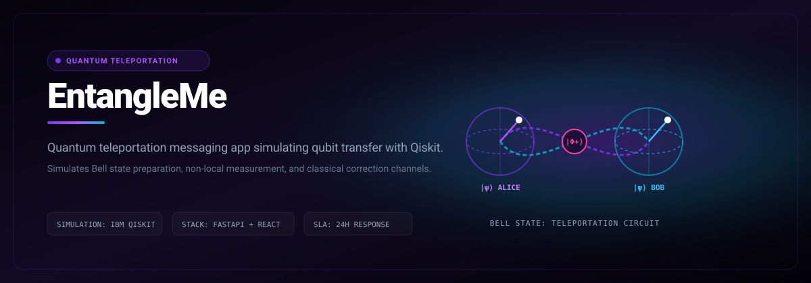

# EntangleMe

> Quantum teleportation messaging app simulating qubit transfer with Qiskit and interactive web UI.



<p align="center">
  
  &nbsp;
  
  &nbsp;
  
  &nbsp;
  
  &nbsp;
  
  &nbsp;
  
</p>

<p align="center">
  <a href="https://luxion-labs.github.io/EntangleMe/"></a>
  &nbsp;
  <a href="LICENSE"></a>
  &nbsp;
  <a href="CONTRIBUTING.md"></a>
</p>

---

## Quick Start & Getting Started

Getting EntangleMe running locally takes two steps:

```bash
git clone https://github.com/Luxion-Labs/EntangleMe.git
cd EntangleMe
pip install -r requirements.txt
```

Launch the simulation backend:
```bash
uvicorn main:app --reload --port 8000
```

---

---

##  **Live Demo**

-  **Frontend Application:** [https://entangleme.vercel.app/](https://entangleme.vercel.app/)
-  **Backend API:** [https://entangleme.onrender.com/](https://entangleme.onrender.com/)
-  **API Documentation:** [https://entangleme.onrender.com/docs](https://entangleme.onrender.com/docs)

---

##  **Tech Stack**


---

##  **Documentation**

### ** Core Documentation**
-  **[Complete Project Documentation](docs/docs.md)** - Overview and setup guide
-  **[System Architecture & Implementation](docs/EntangleMe.md)** - Detailed technical architecture
- ️ **[Quantum Implementation Guide](docs/QUANTUM_VISUAL_SUMMARY.md)** - Quantum computing implementation details
-  **[Quantum Simulation Proof](docs/QUANTUM_SIMULATION_PROOF.md)** - Proof of real quantum implementation
-  **[Quantum Visualization System](docs/QUANTUM_VISUALIZATION.md)** - Frontend quantum visualization components
-  **[Quantum Circuit Diagrams](docs/QUANTUM_CIRCUIT_DIAGRAM.md)** - Detailed circuit diagrams and explanations

### ** Setup & Configuration**
- ️ **[Setup Guide](SETUP.md)** - Complete installation and setup instructions
-  **[Classiq + IonQ Setup](docs/CLASSIQ_IONQ_SETUP.md)** - Quantum hardware integration setup

### ** Testing & Troubleshooting**
-  **[Testing & Troubleshooting Guide](GUIDE.md)** - Common issues, solutions, and debugging information

---

##  **Quick Start**

### **Prerequisites**
- Python 3.10+
- Node.js 18+
- Git

### **Local Development**

1. **Clone the repository**
   ```bash
   git clone https://github.com/dev-Ninjaa/EntangleMe.git
   cd EntangleMe
   ```

2. **Backend Setup**
   ```bash
   cd backend
   python -m venv venv
   source venv/bin/activate  # On Windows: venv\Scripts\activate
   pip install -r requirements.txt
   python run.py
   ```

3. **Frontend Setup**
   ```bash
   cd frontend
   npm install
   npm run dev
   ```

4. **Access the application**
   - Frontend: http://localhost:5173
   - Backend: http://localhost:8000
   - API Docs: http://localhost:8000/docs

---

##  **Production Deployment**

### **Backend (Render)**
-  **Deployed:** [https://entangleme.onrender.com/](https://entangleme.onrender.com/)
-  **Status:** Active and running

### **Frontend (Vercel)**
-  **Deployed:** [https://entangleme.vercel.app/](https://entangleme.vercel.app/)
-  **Status:** Live with quantum visualization

### **Environment Variables**

**Backend (Render)**
```bash
HOST=0.0.0.0
PORT=8000
DEBUG=False
SECRET_KEY=your-super-secret-key
DATABASE_URL=your-database-url
REDIS_URL=your-redis-url
```

**Frontend (Vercel)**
```bash
VITE_API_URL=https://entangleme.onrender.com/api/v1
```

---

## ️ **Core Concept**

**EntangleMe** follows actual quantum teleportation principles:
> **Entangle → Encode → Measure → Send Classical Bits → Apply Corrections**

This is the same foundation used in **quantum internet** and **secure quantum communication**.

### ** How It Works**

1. **Quantum Teleportation**: Simulates quantum teleportation of `0` or `1` using IBM Quantum via Qiskit
2. **FastAPI Backend**: RESTful API endpoints for quantum operations and real-time chat
3. **React Frontend**: Modern TypeScript-based interface with real-time quantum visualization
4. **Real-time Chat**: WebSocket-based messaging with quantum state visualization
5. **Quantum Visualization**: Interactive circuit diagrams, state evolution, and teleportation flow

---

##  **Why EntangleMe Matters?**

### **1. Quantum-Resistant Messaging**
By transforming our simulated teleportation pipeline into a true QKD channel, EntangleMe can use the randomly generated measurement outcomes as shared secret keys. After each teleportation, those key bits encrypt classical payloads - guaranteeing that any eavesdropping attempt is immediately detectable.

### **2. Hybrid Quantum-Classical Workflows**
Not all users have direct access to quantum hardware. EntangleMe's modular FastAPI and frontend architecture can be deployed as serverless functions or at the network edge, running lightweight quantum simulations close to the user.

### **3. On-Ramp to the Quantum Internet**
As quantum repeaters and entanglement distribution networks become available, EntangleMe's "simulator-swap" design lets us replace Qiskit's backend with live hardware with minimal code changes.

---

## ️ **We Also Used: Classiq to Auto-Generate Teleportation Circuits**

To simplify or scale the quantum backend, we explored using **Classiq**, a high-level quantum algorithm synthesis platform. Instead of building the quantum circuit manually, Classiq lets us define **intent**, and it builds the optimized circuit for us.

---

##  **Features**

### ** Core Features**
- ️ **Real Quantum Teleportation**: Actual Qiskit quantum circuits for teleportation
-  **Secure Communication**: Quantum-based security principles
-  **Real-time Chat**: Instant messaging with quantum state transmission
-  **Interactive Visualization**: Quantum circuit diagrams and state evolution
-  **Bell Pair Entanglement**: Real quantum entanglement simulation
-  **Success Probability**: Quantum measurement outcome analysis

### ** Frontend Features**
-  **Modern UI**: Beautiful quantum-themed design with animations
-  **Responsive Design**: Works on desktop and mobile devices
-  **Real-time Updates**: Live message polling and status updates
-  **Quantum Dashboard**: Comprehensive quantum visualization system
-  **Interactive Components**: Animated quantum circuits and states

### ** Backend Features**
-  **FastAPI**: High-performance async API framework
- ️ **SQLite Database**: Lightweight data persistence
-  **WebSocket Support**: Real-time communication capabilities
-  **Auto Documentation**: Swagger/OpenAPI documentation
-  **Testing**: Comprehensive test coverage

---

##  **Project Structure**

```
EntangleMe/
├──  backend/                 # FastAPI backend
│   ├──  app/
│   │   ├──  api/            # API endpoints
│   │   ├──  core/           # Configuration
│   │   ├──  database/       # Database layer
│   │   ├──  models/         # Data models
│   │   ├──  schemas/        # Pydantic schemas
│   │   ├──  services/       # Business logic
│   │   └── main.py           # FastAPI app
│   ├── requirements.txt       # Python dependencies
│   └── run.py               # Entry point

├──  frontend/               # React frontend
│   ├──  src/
│   │   ├──  components/     # React components
│   │   ├──  api/           # API client
│   │   ├──  types/         # TypeScript types
│   │   └── main.tsx         # React app
│   ├── package.json          # Node.js dependencies
│   └── vite.config.ts       # Vite configuration

├──  docs/                  # Project documentation
│   ├──  EntangleMe.md     # System architecture
│   ├──  QUANTUM_*.md      # Quantum implementation docs
│   ├──  CLASSIQ_*.md      # Quantum hardware setup
│   └──  docs.md           # Overview documentation
├──  README.md             # This file
├──  SETUP.md              # Setup guide
└──  LICENSE               # MIT License
```

---

## ‍ **Team Members**

| Role        | Name         | GitHub Profile |
|-------------|--------------|----------------|
|  **Lead**     | Md Athar Jamal Makki  | [@atharhive](https://github.com/atharhive)       |
|  **Frontend** | Akshad Jogi  | [@akshad-exe](https://github.com/akshad-exe)     |
|  **Backend**  | Ayush Sarkar  | [@dev-Ninjaa](https://github.com/dev-Ninjaa)      |

---

##  **External Links**

-  **Prototype Website:** [https://entangleme.vercel.app/](https://entangleme.vercel.app/)
-  **Demo Video:** [https://youtu.be/0y06cFS6Wwo](https://youtu.be/0y06cFS6Wwo)
-  **Devpost Project:** [https://devpost.com/software/entangleme](https://devpost.com/software/entangleme)
-  **Hackathon:** [https://cqhack25.devpost.com/](https://cqhack25.devpost.com/)

---

##  **Resources**

### **Quantum Computing**
-  [Qiskit Teleportation Notebook](https://github.com/qiskit-community/qiskit-community-tutorials/blob/master/Coding_With_Qiskit/ep5_Quantum_Teleportation.ipynb)
- ▶️ [Qiskit YouTube Tutorial](https://www.youtube.com/watch?v=mMwovHK2NrE)
- ️ [Classiq Documentation](https://docs.classiq.io/)
-  [IBM Quantum Lab](https://quantum-computing.ibm.com/)

### **Development**
-  [FastAPI Documentation](https://fastapi.tiangolo.com/)
-  [Vite Documentation](https://vitejs.dev/)
-  [Tailwind CSS Documentation](https://tailwindcss.com/)
-  [React Documentation](https://react.dev/)

### **Deployment**
- ️ [Render Deployment Guide](https://render.com/docs/deploy-fastapi)
-  [Vercel Deployment Guide](https://vercel.com/docs/deployments)

---

##  **License**

This project is licensed under the MIT License - see the [LICENSE](LICENSE) file for details.

---

> **Built with ️ +  + ️ during CQHack25**
>
> **A quantum leap into the future of secure communication!** 


---

## Maintainer Response SLA
Luxion Labs enforces a strict 24-hour response SLA on all community issues, feature proposals, and pull requests. See [CONTRIBUTING.md](CONTRIBUTING.md) for full development guidelines.

## License
Distributed under the MIT License. See [LICENSE](LICENSE) for details.
